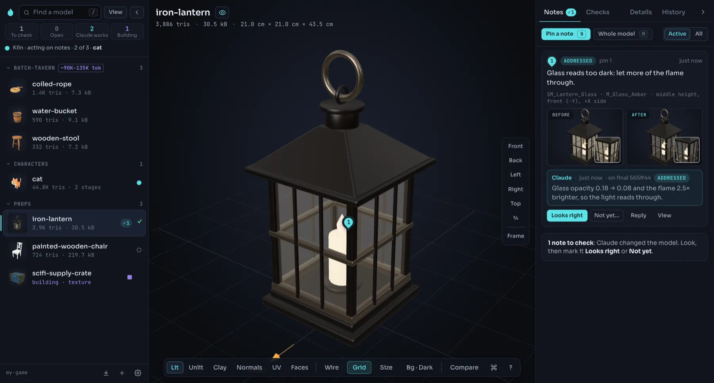
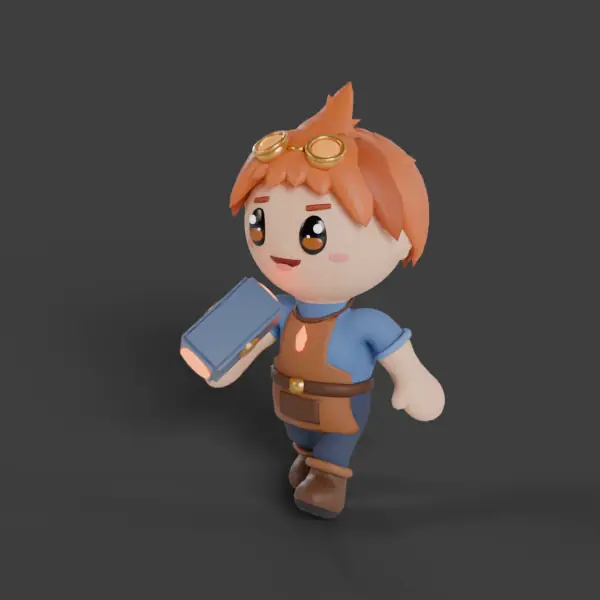
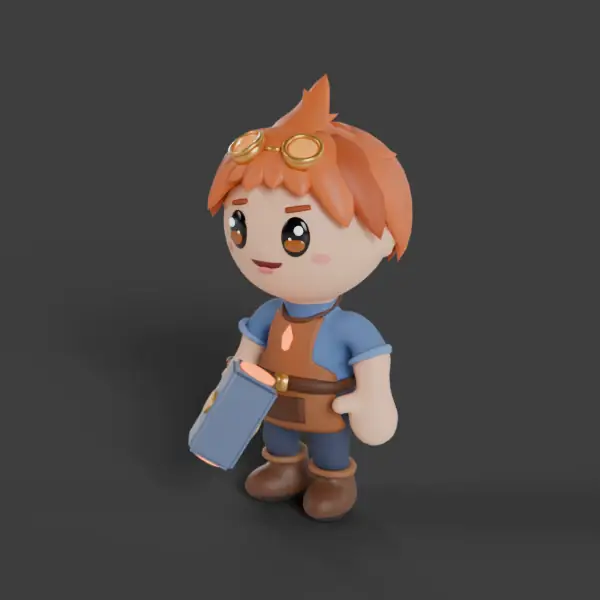

<p align="center">
  
</p>

<h1 align="center">blender-kiln — The 3D Asset Forge</h1>

<p align="center">
  <a href="https://github.com/elithril/blender-kiln/actions/workflows/verify.yml"></a>
  <a href="https://github.com/elithril/blender-kiln/actions/workflows/blender.yml"></a>
  <a href="LICENSE"></a>
  
  
  <a href="https://github.com/elithril/blender-kiln/stargazers"></a>
</p>

**Describe an object, or show a photo of it, and get back a clean 3D model you can edit, ship in a game or on the web, animate, or print.**

kiln is a Claude Code skill on top of a Blender MCP server. The MCP server gives Claude
hands in Blender; kiln gives it the production method — sourcing, modelling, cleanup,
texturing from CC0 scans, optimization, validation, export — and measures the file it
ships. It runs on both servers: [ahujasid's `mcp-for-blender`](https://github.com/ahujasid/mcp-for-blender)
and the Blender Foundation's [official Blender Lab MCP](https://projects.blender.org/lab/blender_mcp),
the server behind Claude's Blender connector.

<sub>Cited in <a href="https://arxiv.org/abs/2606.01057"><i>3DCodeBench: Benchmarking Agentic Procedural 3D Modeling Via Code</i></a> (Google DeepMind, USC, 2026), §1.</sub>

<p align="center">
  
</p>
<p align="center"><sub>From one photo each, no marketplace, no AI generation: scripted in Blender, textured from CC0 scans,
measured against the real object. Shape scores against the real assets: <b>0.888</b>, <b>0.948</b>, <b>0.729</b> —
all three with <a href="#review-rounds--a-fresh-eye-on-every-model">review rounds</a>;
<a href="docs/benchmarks.md">how they are measured</a>.</sub></p>

## Quickstart

```
/plugin marketplace add elithril/blender-kiln
/plugin install blender-kiln@blender-kiln
/kiln setup
/kiln A hanging iron lantern for a medieval inn, stylized, for the web
```

`/kiln setup` detects Blender, the MCP server and the optional tools, and says what is
missing — see [Requirements](#requirements). Then, for example:

```
/kiln Rebuild the lamp in ./lamp.png as a game asset
/kiln optimize ./generated.glb               # a GLB from anywhere: lighter, checked
/kiln animate SK_Cat.glb walk, idle
/kiln A 90 mm windmill for my FDM printer
/kiln studio                                 # look at the models, pin notes, let Claude act on them
```

## What kiln does

Every model comes out clean, named, at real size, on the ground, compressed for the web
(Draco, WebP) and checked — as GLB, FBX, USDZ or STL. On top of that, 3.0 adds:

### Kiln Studio — look at your models, pin a note, let Claude fix it

<p align="center">
  
</p>
<p align="center"><sub>A real session from the 3.0 bench: the note was pinned in the page, Claude made the change and replied on it.<br />
<b><a href="https://elithril.github.io/blender-kiln/#studio">How it works: watch a real session ▶</a></b></sub></p>

A local page that shows every model in your project. Pin a note on a spot — *"the ring is too
small to hang it"* — press **Work on it with Claude**, and the change lands in the model, with
Claude's reply and a before/after on the note. Studio also exports for games and AR in seconds,
and shows the model in AR on your iPhone through a QR code. From the terminal, Claude sees the
model you have open in Studio and can turn it, compare it and present it on a second screen.
Measured: a note addressed in one pass, nothing else moved, for $0.69 of API-equivalent usage.

<details>
<summary><b>Everything Studio does</b></summary>

A local page for looking at what kiln made, telling it what to change, and asking Claude from
the page itself. `/kiln studio` starts it on your project folder (or reuses the one running):
every `.glb .gltf .fbx .obj .usdz .3mf .stl` under it shows up, and kiln's `_original` …
`_final` stages are one model you can switch between.

- **Look** — Lit, Unlit, Clay, Normals, UV checker, Faces (back faces red), wireframe, sizes in
  metres, bones, animation clips with a scrubber; the previous version beside the current one.
- **Annotate** — pin a note on a spot (it records the point in Blender coordinates, the object
  and material hit, the camera, a screenshot and a close-up) or write one about the whole model.
- **Ask Claude from the page** — with "Ask Claude from Studio" on, the page runs Claude Code
  itself (`claude -p`, on its own Blender, never yours): "Work on them with Claude" addresses
  every open note, a conversation per model and one for the project, *New model* asks for a model
  from a sentence or a photo. Safe calls pass; anything else waits for your OK in the page, and
  paid generation asks unless you set it to Auto in Settings. Measured on the bench: a note asking for a ring twice as big,
  addressed in one pass — ×1.9, nothing else moved, the note answered — for $0.69 of
  API-equivalent usage (official Lab MCP: $0.73). Or run `/kiln studio` in your terminal: Claude
  reads the open notes, changes the model, re-exports and replies on each.
- **Claude in your terminal sees what Studio shows** — installed as a plugin, kiln brings a small
  MCP server, `kiln-studio`, with nothing more to set up (a standalone-skill clone does not
  register it). Say *"fix this"* or *"what am I looking at"* and Claude reads
  the model open in the page, its stage, the camera and the note picked, and can grab the image
  you see. It drives the page too: open a model, turn the view to a note's, switch to clay or
  normals, a before/after against the previous version, play a clip, and a present mode for a
  second screen. It replies on notes and leaves its own, and makes variations and finishes when
  you ask; it never touches a model file itself. Tools and when they are called:
  [`references/studio.md` § 11](plugin/references/studio.md#11-the-kiln-studio-mcp-server--what-the-user-is-looking-at-and-driving-studio).
- **Outputs** — Web, Game, AR and 3D print for each model. Game (FBX) and AR (a GLB and a USDZ
  that passes `usdchecker --arkit`) are made by Studio itself, in seconds, without Claude.
  *Download* zips the outputs you pick with a sheet: each file's size and use, the licences.
- **On your phone** — a QR code shows the model in AR on an iPhone (AR Quick Look), on the same
  Wi-Fi, through a read-only link that expires after 15 minutes. Android: not tried yet.
- **Variations and finishes** — new models from a copy of this one ("the same in rusted iron"),
  one Claude run each, several at once if you allow it; finishes are kept in one file
  (`KHR_materials_variants`) and the AR view lets you pick one.
- **Check** — the Checks tab reads the file in plain words, each with how to fix it: triangles
  against the detail tier, size and ground contact, texture sizes, compression, the licences
  the log records, and the fidelity measure against the reference photo.
- **Watch it built** — once the brief is confirmed, the page opens the model kiln is building
  and reloads it after each phase; a dot per model shows what kiln is on.
- Every command by name (⌘K), seven themes (high contrast among them), English and French, a
  playable tutorial on an example model, a tip the first time you meet each feature.

**No extra service.** Studio is a Python standard-library server bound to `127.0.0.1`; only
the phone link reaches your local network. Claude runs on the account you choose in Settings —
your Claude subscription by default; another Claude account or an API key are supported but
**not yet tested with a real one**. Notes live in the project's `.kiln-studio/`, ready to commit
with the models. [`references/studio.md`](plugin/references/studio.md) is the reference.

</details>

### 3D printing — models that actually print

<p align="center">
  </p>

<!-- [PHOTOS — shooting 2026-10-28: the four objects kiln modelled for print on 2026-10-13, printed by a
colleague on a Bambu Lab P1S in PLA, no touch-up — the forge of the logo (3 parts, 70 mm), the lighthouse
(50 mm), the Art Deco box with a bayonet lid (Ø 62 mm), the windmill (2 parts, 90 mm). Caption: "Printed on a
Bambu Lab P1S, PLA, 0.2 mm layers, as kiln exported them".] -->

Say it will be printed — FDM or resin, a height, your printer's colours — and kiln models for the
printer from the first primitive: closed solids at size, walls thick enough, a flat base, parts
that fit together, one file per colour. Every file is checked, with PrusaSlicer as a second
opinion. In the bench, the 3.0 passed both prints the 2.2.0 had half-failed; four objects kiln
modelled were printed as exported, on a Bambu Lab P1S.

<details>
<summary><b>How print mode works, and its limits</b></summary>

Say it will be printed — FDM or resin, a height, your printer's colours — and kiln models
**for the printer from the first primitive**: at size, in closed solids joined into one
volume, walls thick enough (0.8 mm FDM, 0.5 mm resin), a flat base, overhangs designed out
where nobody looks, relief as geometry, and in several parts when one would print in the
air — the windmill above is a body and its sails, laid flat, each checked on its own. STL in
millimetres. Every STL ends with [`tools/print_check.py`](plugin/tools/print_check.py): open and
non-manifold edges, normals, held and floating parts, walls, overhangs, loss against the
original, the smallest scale you can shrink it to in the slicer, and PrusaSlicer as a
second opinion ([`references/print.md`](plugin/references/print.md)).

<p align="center">
  
</p>

Measured on sessions given the skill and nothing else: a dog house and a lighthouse from a
brief, a pumpkin and a ghost from photos, the windmill, and this teapot from three museum
photos — printable, and like what was asked.

**Stylised figures, not likenesses.** Two cats — one held by the ghost, one from a real cat's
photo — passed every check and were unacceptable to look at. A stylised figure is another
matter: a session made a cartoon dragon from one flat drawing, in four colour parts, from
**metaball families and one voxel remesh**, and a fresh session then made a cartoon fox the
same way. So print mode builds a stylised figure that way, and says at CONFIG that a
realistic likeness of a real animal or person is out of reach of scripted modelling.


### A model you made: flatten it, then check it

<p align="center">
  
</p>

A model finished by hand often has faces that should be flat and are not, and sits a degree
off. [`tools/flatten.py`](plugin/tools/flatten.py) makes nearly flat faces exactly flat and lays the
base on the bed — on the windmill above, **629 mm of first layer become 3,317** — and touches
nothing else: curves, folds, bevels and real slopes stay, no vertex moves past the tolerance,
the input is never overwritten.

```
/kiln inspect model.stl     # print mode: print_check's verdict
/kiln cleanup model.stl     # print mode: flatten.py, then print_check again, before and after shown
```

### Limits

- **Printed, four of them.** The forge, the lighthouse, the Art Deco box and the windmill were
  printed as kiln exported them, on a Bambu Lab P1S in PLA.
  The box's bayonet lid turns, locks and holds with the box upside down. The fit test print was not printed; the
  rest was checked by PrusaSlicer 2.9.6 and by renders, not on a bed.
- **FDM, checked with PrusaSlicer's default profile.** No resin slicing, no orientation search,
  no support generation, no build-volume check.
- **Scaled down in the slicer, a model loses its thin walls.** `print_check` says how far —
  "do not shrink below 40 %" for the windmill's body, 67 % for the lighthouse.
- **Parts are glued or pressed, never moving.** 0.2 mm a side is a usual clearance, not
  measured here; [`tools/fit_coupon.py`](plugin/tools/fit_coupon.py) writes the test print that
  measures it on your printer.
- **Decorative objects, not mechanical parts.** A bracket, or a box whose lid must close, belongs
  in a CAD tool (build123d, CadQuery, OpenSCAD).
- **No multi-material file.** A colour is painted, or printed as its own part.
- **Self-intersections are counted, not repaired**, and `flatten.py` does not fill holes.

The full list is in [`references/print.md`](plugin/references/print.md) § What it does not check.
The teapot photo is the Auckland War Memorial Museum's, CC BY 4.0, via Wikimedia Commons.

</details>

### From a photo — rebuilt in Blender, measured against the real object

<p align="center">
  
</p>
<p align="center"><sub>Every panel is a file the session itself wrote while rebuilding the ammo box above — nothing re-staged.</sub></p>

Give it a photo and kiln rebuilds the object by script, textures it from CC0 scans, and measures
its silhouette and materials against the photo before shipping. Against the real 3D object the
photo was taken of: an ammo box at **0.948** with review rounds (0.936 on the bench, before them), a
hurricane lantern at **0.888** (0.885 before them), **0.946** when kiln finishes a TRELLIS.2 mesh of the
photo ([the numbers](#measured-not-claimed)).

<details>
<summary><b>The five steps</b></summary>

1. **Read the photo before modeling.** An inventory of every part and how it meets the next,
   from enlarged crops; the real size, the camera's height and angle — asked, or stated as
   assumptions. Given a 3D mesh generated from the same photo, its proportions are measured
   instead ([TRELLIS.2, locally](plugin/references/ai-generation.md)) — never shipped.
2. **Texture from scans, not noise.** A Poly Haven CC0 texture set of the material family,
   chosen by eye against the photo, tinted to its palette, worn by the form.
3. **Measure against the photo.** [`plugin/tools/fidelity_check.py`](plugin/tools/fidelity_check.py) renders
   the model at the photo's camera under a studio light and lists the gaps — silhouette per
   height band, materials, metal that cannot exist.
4. **Look at every joint.** Each end of a long part that touches another is rendered alone: a
   part that joins another enters it.
5. **Ship, and measure the file that ships.** Optimized (Draco, WebP), validated, re-measured
   as a GLB — what the user gets, not the `.blend`.

</details>

### Animate, and characters that bend

<p align="center">
  
  
  
</p>
<p align="center">
  
  
  
  
</p>

`/kiln animate` picks the route from the subject: ready-made humanoid moves (22 motions),
text-to-motion for bipeds and winged creatures, a measured walk and idle for quadrupeds, keyed
parts for objects. Characters are built as one skin and rigged by a learned auto-rig: skin
crossing skin when they bend went from 3.15 % to 0 % on the bench's villager.

<details>
<summary><b>Routes, characters and their limits</b></summary>

`/kiln animate` picks the route from the subject, because no single method held up across
all of them ([`references/animation.md`](plugin/references/animation.md) has every measurement):

| Subject | Route | Shown above |
|---|---|---|
| Humanoid, a ready-made move | `tools/presets.py` — 22 motions made with NVIDIA Kimodo, retargeted, feet planted and flat | the mascot |
| Biped or winged, from a sentence | [UniMate](https://github.com/Friedrich-M/UniMate) text-to-motion, looped by `tools/motion_loop.py` — **non-commercial weights** | the dragon |
| Four-legged, idle and walk | `tools/quadruped.py` — a scripted, measured cycle | the cat |
| Articulated object | rigid parts keyed by script, every rotation's sign measured first | the lamp, the chest |

UniMate was measured **unusable for quadruped walking** — on a cat, a Shiba, a horse and the
model author's own robot dog — so a quadruped never goes to it.

> **What this showcase is, and is not.** Each UniMate tile is the sample, out of 4, that
> `motion_loop.py` kept for looping best, then approved by a reviewer — some prompts tried
> (wave, dance, run) were left out. The scripted tiles are deterministic. These come from
> scripts (`examples/animation/showcase.sh`), not from an interactive session.

### Organic characters

A character is built as **one skin** — families of metaballs or overlapping volumes, joined by
a single voxel remesh — so it bends without seams at the shoulders, hips and neck. Then:

- **A learned auto-rig.** A humanoid, or a mesh kiln did not build (a generated one), is rigged
  by [SkinTokens](https://github.com/VAST-AI-Research/SkinTokens) (MIT, runs locally) and handed
  back with kiln's skeleton: Mixamo names, weights cleaned, eyelid and ear bones added. A
  quadruped kiln built keeps its own rig, which walked better. On the bench, skin crossing skin
  when the character bends: **3.15 % → 0 %** on a low-poly villager, **1.34 % → 0 %** on a chibi,
  **0.74 % → 0.45 %** on a generated humanoid, against 2.2.0's rig.
- **Ready-made humanoid moves.** `tools/presets.py` puts 22 motions (walk, run, jump, dance…;
  43 clips, NVIDIA Kimodo, commercial use allowed) on a kiln-named humanoid, with the feet
  planted, the arms kept out of the body, and `--loop` for a closed in-place cycle.
- **Looped clips that close** — one clip per file, the last key equal to the first; a walk loop
  for a game, beside the whole take.

Limits, measured: the auto-rig was compared on one pose of two humanoids, and runs differ; a
generated humanoid with a hand fused to its hip keeps skin through skin on its arms; SkinTokens
needs about 5.6 GB on disk and 7 GB of memory per mesh. `references/characters.md` has every
table.

</details>

### A GLB from a generator — repaired, lightened, converted

Bring the file a generator gave you: kiln inspects it, repairs it, lightens it and converts it.
On the bench, a raw TRELLIS output went from 191,520 triangles and 11.4 MB, full of holes, to
9,000 triangles, 0.63 MB, closed — in 16 minutes.

<details>
<summary><b>The commands, and what was measured</b></summary>

| Command | What it does to your file |
|---|---|
| `/kiln inspect model.glb` | faces (tris / quads / ngons), vertices, objects, materials, textures and their sizes, bounding box, rig, animations |
| `/kiln cleanup` | merge by distance, recalculate normals, remove loose parts, dissolve degenerate faces, check for fused edges, apply transforms, origin at the centre of the base, scale check (1 unit = 1 m), rename to convention, clean orphans, check materials |
| (poly count) | reported against the detail tier; past twice its top, a **decimation is proposed with before/after previews — never applied without you**. Thin parts (wires, handles, loops) are rebuilt as curves instead of decimated |
| `/kiln texture` | textures a white or untextured mesh — Poly Haven CC0 scans first, procedural second; works on a single fused mesh by grouping faces |
| `/kiln optimize model.glb` | textures resized and converted to WebP, Draco geometry compression, or gltfpack simplification and LODs — each shown before/after, kept only if you say so |
| `/kiln convert` | GLB ↔ FBX, OBJ → GLB, to USDZ, with the material export audit before any glTF export |
| `/kiln animate` | folds bone-parented parts into the skin, checks the rig can bend where asked, then animates ([Animate](#animate-and-characters-that-bend)) |

- **A generator's GLB, repaired end to end** (bench brief `repair-trellis-glb`, a raw TRELLIS
  output): 191,520 triangles, 11.4 MB, 13,732 non-manifold and 10,220 open edges → **9,000
  triangles, 0.63 MB, 0 and 0**: the glass globe, too thin to survive a remesh, refilled with a
  lathe shape fitted to its profile, the whole closed by a voxel remesh and decimated with
  Blender's Collapse — 16 minutes, $3.89 of API-equivalent usage. On the official
  Lab MCP: the same 0 and 0, 0.93 MB.
- **A generated lantern finished as a game asset** (`ref-lantern-trellis`): shape kept, surface
  rebuilt, **0.946** against the real lantern's 3D model (2.2.0: 0.934 — [how it is scored](#measured-not-claimed)).
- **From a sentence, through the free Hugging Face Spaces** (`ai-mushrooms`): a FLUX.1-schnell
  concept, then TRELLIS.2 (MIT, one 89 s call), decimated to 8,991 triangles, textured, shipped at
  279 KB — 12 minutes, $3.80. kiln 2.2.0 went to Hunyuan3D-2 for the same brief, whose licence
  excludes the EU, the UK and South Korea; 3.0 uses it only when asked.

</details>

### Review rounds — a fresh eye on every model

A session that looks at its own model sees what it meant to make. So each model goes through
review rounds: six views and a close-up, in colour and in clay, read each round by a new Claude
subagent that knows the brief and the photo, never the build. It lists every defect, blocking or
detail; the rounds end when two new reviewers in a row find nothing blocking. A prop has no
minimum and eight rounds at most; a character or a showcase brief, six at least and twelve at
most, then rounds on its motion.

Measured after the bench, one run each: on a mascot, the first reviewer found 16 defects the
session had passed (a hair flame read as horns, palms without fingers, a bald nape), and the walk
no longer snaps the knees; against the real object, the chair from a photo 0.720 → 0.729, the
ammo box 0.936 → 0.948 and the lantern 0.885 → 0.888 (eight rounds, the cap: its reviewers
disagreed on the tone) — within one session's spread for the scores, so the clearer gain is what
the reviewers catch. The price: about twice the time and usage (the ammo box $4.45 → $9.17, the
chair $6.64 → $14.39, the lantern $6.04 → $13.19). [`references/review-rounds.md`](plugin/references/review-rounds.md)

### No Blender open — built in the background, several at once

Blender closed, or busy with your own work: kiln builds in a background Blender instead, saves
the `.blend` there and renders its own check views (two opposite three-quarters, top and under)
— the look is never skipped, and the report says the model was built headless. `/kiln batch`
makes a series from one manifest, unattended (three props in 7.8 minutes on the bench), and
Kiln Studio runs variations up to four at once (Settings → At once).

## Measured, not claimed

Each rebuild from a photo is scored against the real 3D object it was photographed from — an
asset the session never sees. Blender 5.2.2, Opus 5.5, one run each, October 2026:

| Against the real object (1 = identical) | **2.2.0** | **3.0** | 3.0 shipped | Usage (API-equivalent) |
|---|---:|---:|---:|---:|
| Hurricane lantern, from a photo | 0.900 | 0.885 | 1.18 MB | $6.04 |
| The lantern, with a measured template | 0.880 | **0.917** | 474 KB | $7.16 |
| The lantern, from a TRELLIS.2 mesh | 0.934 | **0.946** | 465 KB | $6.43 |
| Ammo box, from a photo | 0.774 | **0.936** | 373 KB | $4.45 |
| Gothic chair, from a photo | 0.637 | **0.720** | 449 KB | $6.64 |

The bench ran before [review rounds](#review-rounds--a-fresh-eye-on-every-model). With them, one run
each: the lantern 0.888 (612 KB, $13.19), the ammo box 0.948 (493 KB, $9.17) and the chair 0.729
(505 KB, $14.39) — the three shown at the top.

Across the whole bench, 3.0 against 2.2.0: both prints pass the printability check (2.2.0: one of
two), the humanoids kiln builds no longer pass skin through skin when they bend, and a note in Kiln Studio is addressed
in one pass. It costs about 40 % more usage, for the new checks and the work they do.

<details>
<summary><b>The whole bench, time per task, and how it is scored</b></summary>

| The whole bench — 19 briefs both versions ran, plus Kiln Studio | 2.2.0 | **3.0** |
|---|---:|---:|
| Briefs that shipped their files | 19 of 19 | 20 of 20 |
| Prints passing the printability check (PrusaSlicer second opinion) | 1 of 2 | **2 of 2** |
| Rig interpenetration when bent — villager / chibi | 3.15 % / 1.34 % | **0 % / 0 %** |
| A note pinned in Kiln Studio, addressed by Claude | — | **passed, $0.69** |
| Usage for the 19 briefs (API-equivalent) | $54.06 | $75.87 |
| The same 20 briefs on the official Lab MCP | — | 20 of 20, $84.97 |

> **About the usage column.** On a Claude Pro or Max subscription, these sessions are
> included in your plan's usage — there is nothing extra to pay. The dollar figure is what
> the same session would have cost on the Anthropic API (Claude Code's `total_cost_usd`);
> the bench uses it to compare versions, and as a rough measure of how much of your plan's
> usage a run takes. kiln itself never pays for a service (rule 5).
<!-- Do not write "free": a subscription is not free, and plan limits apply. -->

<sub>Shape score: mean silhouette overlap with the real asset from front, back, sides and top
(`bench/gt_compare.py`); openwork views left out for the chair. Size is assumed when a brief gives
none, and a single photo does not give it: every lantern came out 20 to 50 % taller than the real
one. One run per brief, and runs of the same skill differ by about ±0.02–0.03. 3.0 costs about 40 %
more than 2.2.0: the new checks (render reviews, UV, printability), the learned auto-rig, closed
loops and the photo projection are extra work in the session. Three photo briefs and the
generator repair were re-run after fixes the bench itself found — what changed and why is in the
[CHANGELOG](CHANGELOG.md).</sub>

**Close, not identical, on purpose.** kiln stops at a few dollars of API-equivalent usage per object.
[img2threejs](https://github.com/img2threejs/img2threejs), which rebuilds an image as Three.js
code through eight vision-reviewed passes, keeps finer surface detail: on the same lantern its
likeness was comparable — 0.866 against kiln v7's 0.861 (2.0 era) — at about three times the usage, estimated on
a run stopped after three of its eight passes
([benchmarks § 4](docs/benchmarks.md#4-kiln-against-an-image-to-code-tool)).

What did not improve is published too: the [benchmarks](docs/benchmarks.md) — eighteen
versions of one lantern, what each fix broke, how the bench was kept honest — and every
number, render and GLB under 1 MB on the [`bench-results`](https://github.com/elithril/blender-kiln/tree/bench-results) branch, except the
humanoid derived from Hunyuan3D, whose licence keeps it out.
<!-- [À FAIRE avant la sortie: publier v220-mcp222-ahujasid, v300final-ahujasid et v300final-lab sur bench-results (bench/publish.py) — sur feu vert] -->

### How long it takes

Time Claude spent on whole headless sessions in the bench (auto mode, every question answered
in the brief, so no time waiting for you), Blender 5.2.2, skill 3.0, one run each, October 2026.
An interactive session adds your answers.

| Task | ahujasid MCP | Official Lab MCP |
|---|---:|---:|
| Scripted prop from a text brief (lantern) | 3.5 min | 3.6 min |
| A Poly Haven model imported and finished (chair) | 3.5 min | 3.0 min |
| PBR texturing (crate) | 6.3 min | 7.0 min |
| Rigged character (villager) | 7.1 min | 6.5 min |
| Batch brief (three props) | 7.8 min | 8.6 min |
| AI brief (FLUX + TRELLIS.2 Spaces) | 12.3 min | 16.6 min¹ |
| **Rebuild from a photo** (lantern / ammo box / chair) | 18.3 / 15.3 / 23.0 min | 19.1 / 19.1 / 16.7 min |
| A generator's GLB repaired (TRELLIS lantern) | 16.0 min | 15.0 min |
| Humanoid rigged and walking (chibi) | 12.8 min | 9.3 min |
| Quadruped walk and idle (cat) | 12.9 min | 21.6 min |
| 3D print: a 4-colour figurine / a box with a bayonet lid | 16.6 / 6.3 min | 10.9 / 7.2 min |
| Kiln Studio: a pinned note addressed | 1.4 min | 1.5 min |

<sub>¹ The free Hugging Face quota was spent that day: the session fell back to scripted modelling, as the skill says to, and paid for nothing.</sub>

Single steps, measured where stated:

| Step | Time | Source |
|---|---:|---|
| UniMate, one clip | 18 s on an M4 Pro | CHANGELOG 2.1.0 |
| UniMate install | 77 s with warm package caches; several minutes the first time | `references/animation.md` |
| Local TRELLIS.2, one model | 5–7 min on an M4 Pro, 24 GB | benchmarks § 7 |
| TRELLIS.2 HF Space, one generation | 89 s for the call; it reserves 60–120 s of the free ZeroGPU quota (about 3.5 min a day on a free account: one concept image plus one model) | bench, October 2026 |
| Concept art, FLUX.1-schnell Space | 5.6 s an image | CHANGELOG |
| Stylised print figure (cartoon dragon, four colour parts) | 23 min, one v2.2 session | `references/print.md` |
| A print object from a brief (end to end) | 6 to 17 min — a box with a bayonet lid, a 4-colour figurine | bench, October 2026 |
| The fit test print (`fit_coupon.py`) | about 20 min — PrusaSlicer's estimate, not timed on a printer | CHANGELOG 2.3.0 |
| Repair and optimize a generator's GLB (191,520 → 9,000 triangles) | 16 min | bench, October 2026 |
| Kiln Studio, a note addressed (read → change → re-export → reply) | 1.4 min of Claude, 2.4 min with Studio's Blender starting | bench, October 2026 |

</details>

## Built with kiln

Projects people made with kiln. Their pictures are in [the gallery on the site](https://elithril.github.io/blender-kiln/#built).

| | Project | What kiln made |
|:-:|---|---|
| <a href="https://github.com/MartySalade"></a> | **[Token Kingdom](https://token-kingdom.com)**<br />[@MartySalade](https://github.com/MartySalade) | 22 buildings, one GLB per level, 101 in all, assembled by script through Blender MCP. Pieces: KayKit Medieval Hexagon Pack, Kay Lousberg, CC0. |
| <a href="https://github.com/QuegoFreki"></a> | **[My Little Workout](https://mylittleworkout.com/)**<br />[@QuegoFreki](https://github.com/QuegoFreki) | 112 exercises, illustrated and animated by headless Blender scripts. |
| <a href="https://github.com/MushkyQT"></a> | **Zeus Incremental FPS: Olympus**<br />[@MushkyQT](https://github.com/MushkyQT) | 25 game-ready models for the game's Olympus, temple, statues of the gods and throne, with the Blender source. |
| <a href="https://github.com/MushkyQT"></a> | **Imprint**<br />[@MushkyQT](https://github.com/MushkyQT) | The ink-sweeper, the dart and the paper plane, modelled in 3D, rendered at 8x, then turned into the game's pixel-art sprites. |

Built something with kiln? [Share it](https://github.com/elithril/blender-kiln/issues/new?template=share-what-you-built.yml) —
it goes on the site and here once it has been looked at, credited to you.

## Requirements

| | Needed | Notes |
|---|---|---|
| **Claude Code** | yes | with a Claude subscription (Pro, Max) or an API key — usage, see [above](#measured-not-claimed) |
| **Blender** | **4.4 or newer** | hard floor: the animation code uses layered actions (4.4+). Measured on **5.0** locally and on the current stable release in CI (5.2 LTS); the bench ran 5.2.2. 4.4–4.5 satisfy the API but are untested |
| **A Blender MCP server** | yes, one of the two | [ahujasid's `mcp-for-blender`](https://github.com/ahujasid/mcp-for-blender) (addon on port 9876, `uvx mcp-for-blender install-addon`; the bench pinned 2.2.2) or the [official Blender Lab MCP](https://projects.blender.org/lab/blender_mcp) |
| **GPU** | no | the default path is Claude scripting Blender: no AI model, nothing to install |
| **Python 3** | yes | the tools and Kiln Studio use the standard library only |
| `gltf-transform` (Node) | strongly recommended | `npm install -g @gltf-transform/cli` — WebP, Draco and the Khronos validator every export runs |

<details>
<summary><b>Optional tools</b></summary>

| | Needed | Notes |
|---|---|---|
| `gltfpack` | optional | `npm install -g gltfpack` — simplification, LODs |
| Sketchfab API token | optional | free account, for marketplace downloads |
| **3D printing:** PrusaSlicer | optional | second arbiter for `print_check` (`--slicer`); measured with 2.9.6 |
| **3D printing:** macOS 14+ | optional | `tools/cutout.swift` cuts a photo's subject out with macOS Vision, locally |
| **Kiln Studio:** a browser | yes, for Studio | with a network connection: three.js 0.186.1 loads from jsDelivr. No extra API key — see [Kiln Studio](#kiln-studio--look-at-your-models-pin-a-note-let-claude-fix-it) |
| Local TRELLIS.2 | optional, never required | measured on an M4 Pro with 24 GB: 31 GB of weights, 19.5–22.5 GB of memory at peak |
| SkinTokens (learned auto-rig) | optional | offered by `/kiln setup`, asked first: about 5.6 GB, MIT, Apple Silicon through kiln's patch; 35–54 s and about 7 GB of memory per mesh |
| UniMate (text-to-motion) | optional | 3.2 GB on disk; upstream is NVIDIA-only, kiln's patch runs it on Apple Silicon (measured on an M4 Pro) and CPU |

The bench ran on an Apple M4 Pro with 24 GB of memory, macOS, Blender 5.2.2.

</details>

## What you can ship

kiln's own code is MIT. What you can do with an asset depends on where its parts came from,
and kiln writes each source and its licence into the asset's production log
(`<name>_log.md`). Kiln Studio's Checks tab reads those entries back ("credit the author",
"not for commercial use").

<details>
<summary><b>Licences, source by source</b></summary>

| Source | Licence | What it means for you | Checked in |
|---|---|---|---|
| **Scripted modelling** (the default) | — | geometry Claude wrote in Blender for you; no third-party model involved | — |
| **Poly Haven** textures, HDRIs, models | **CC0** | "use the work in any way and for any purpose, including commercial purposes", no attribution required. Using their *live API* asks for a credit to Poly Haven, which kiln writes in the log | [polyhaven.com/license](https://polyhaven.com/license); [`Public-API` ToS](https://github.com/Poly-Haven/Public-API) §2.4–2.5 |
| **Sketchfab** downloads | **per model**: CC0, CC BY, CC BY-SA, CC BY-NC, ND variants, or Sketchfab's Standard licence | read on each model's page. kiln shows the licence in search results, logs it, alerts when attribution is required, and never downloads a CC BY-NC model for a commercial project without asking | [Sketchfab Help](https://help.sketchfab.com/en/articles/16152217) |
| **TRELLIS.2** (Space or local) | code and weights **MIT** | — but two parts are not: its background remover **RMBG-2.0 is CC BY-NC 4.0** (the Space uses it on any image without an alpha channel — send a cut-out), and its image encoder **DINOv3** is under Meta's **DINOv3 License** (gated, your account's acceptance) | [TRELLIS.2 LICENSE](https://github.com/microsoft/TRELLIS.2/blob/main/LICENSE); [DINOv3 LICENSE](https://github.com/facebookresearch/dinov3/blob/main/LICENSE.md); Space `app.py` read 2026-10-09 |
| **TRELLIS** Space (`trellis-community`), **TripoSR** Space | MIT; TRELLIS's background removal is `rembg` (MIT) + U²-Net (Apache-2.0) | — | `references/ai-generation.md` |
| **Hunyuan3D 2.0 / 2.1** (Space, local, MCP) — on request only | **Tencent Hunyuan 3D Community License** | **not licensed in the European Union, the United Kingdom or South Korea.** Line 3 of the licence: *"THIS LICENSE AGREEMENT DOES NOT APPLY IN THE EUROPEAN UNION, UNITED KINGDOM AND SOUTH KOREA"*; §5(c) forbids using the works **or their Output** outside that Territory; services above 1 million monthly active users need a licence from Tencent (§4) — section numbers from the 2.0 text; 2.1 opens with the same line. kiln never proposes it first, quotes that line and waits for a yes | [Hunyuan3D-2 LICENSE](https://github.com/Tencent-Hunyuan/Hunyuan3D-2/blob/main/LICENSE), [Hunyuan3D-2.1 LICENSE](https://github.com/Tencent-Hunyuan/Hunyuan3D-2.1/blob/main/LICENSE) |
| **UniMate** (text-to-motion) | code MIT; **checkpoints CC BY-NC 4.0** | **non-commercial use only**; kiln treats the motions it generates as covered too, and says so before running it | [UniMate README § License](https://github.com/Friedrich-M/UniMate#%EF%B8%8F-license); [model LICENSE](https://huggingface.co/Linzhan/UniMate/blob/main/LICENSE) |
| **Kimodo** motions (`tools/presets.py`, shipped in `tools/motions/`) | **NVIDIA Open Model License** | commercial use allowed; NVIDIA claims no ownership of its outputs | [`plugin/NOTICE`](plugin/NOTICE) |
| `tools/quadruped.py`, keyed props | MIT (kiln) | scripted cycles, no model weights | — |
| **FLUX.1-schnell** concept art | Apache-2.0 | concept images only, never shipped in the GLB | `references/ai-generation.md` |
| Mixamo (optional, humanoids) | Adobe account, Adobe's terms | [not checked here] | `references/characters.md` |

<sub>Licences read on 2026-10-16. This is a summary, not legal advice: read the licence before
shipping anything commercial.</sub>

</details>

## Installation

```
/plugin marketplace add elithril/blender-kiln
/plugin install blender-kiln@blender-kiln
```

Then run `/kiln setup` to detect your environment and install what's missing.

<details>
<summary><b>As a standalone skill, and what a plugin installs</b></summary>

### As a standalone skill

```bash
git clone https://github.com/elithril/blender-kiln.git ~/.claude/skills/blender-kiln
```

Restart Claude Code, then run `/kiln setup`. The skill itself lives in `plugin/`; the
repository root links `SKILL.md`, `references` and `tools` to it, so a clone works as a
skill directory as it is. On Windows, enable symlinks in git (`core.symlinks`) or install
as a plugin.

### Layout

A plugin install ships only `plugin/` — about 5 MB (2.2 MB of ready-made motions, 1.4 MB of Studio's page):

```
plugin/
├── .claude-plugin/plugin.json
├── SKILL.md
├── LICENSE
├── NOTICE                        # third-party code and licences kiln adapts (image-to-3dlab, SkinTokens patch, …)
├── .mcp.json                     # the kiln-studio MCP server: what you look at in Studio, from Claude Code
├── tools/                        # checks: fidelity_check, print_check, uv_check, review_renders, check_usdz · build: template_profile, flatten, fit_coupon, photo_project, cutout · rig and motion: autorig, quadruped, presets (+ motions/), retarget, motion_measure, motion_loop, bind_rigid_parts, unimate (+ patch) · export: export_outputs, glb_to_fbx, glb_to_usdz · Blender: open_blender, blender_mcp_start · verify_docs, verify_blender
├── studio/                       # Kiln Studio: studio.py (CLI), server.py, studiolib.py, checks.py, worker.py (Claude from the page) + approval_hook.py, mcp_server.py, phoneshare.py (AR by QR code), handoff.py (downloads), blender_live.py, static/ (the page), tests
└── references/
    ├── ai-generation.md
    ├── animation.md
    ├── batch-mode.md
    ├── blender-mcp.md
    ├── characters.md
    ├── cli-tools.md
    ├── commands.md
    ├── export-targets.md
    ├── log-format.md
    ├── naming-conventions.md
    ├── photo-projection.md
    ├── pipeline-brief.md
    ├── pipeline-import-cleanup.md
    ├── review-rounds.md
    ├── pipeline-optimize-export.md
    ├── pipeline-rig-animate.md
    ├── pipeline-source.md
    ├── print.md
    ├── reference-fidelity.md
    ├── setup-install.md
    ├── setup.md
    ├── sourcing-strategy.md
    ├── studio.md
    ├── texturing-strategy.md
    ├── topology-rules.md
    ├── uv-materials.md
    └── validation-checklist.md
```

</details>

## Reference

<details>
<summary><b>Running over Blender MCP</b></summary>

The skill drives a live Blender through the [Blender MCP](https://github.com/ahujasid/mcp-for-blender)
addon. Below is `SM_Barrel` built, cleaned and exported inside a running Blender
session — object named to convention, sitting on Z=0, ready to export:

<p align="center">
  
</p>

The MCP pass and the headless scripted pass agree **to the byte** — 111.9 kB GLB
either way, same 2,202 triangles, same three materials.

### Check the integrations before you search


All the integrations ship **off**, as shown here. **Iron rule 23** has kiln check them
before any search or generation: on `mcp-for-blender` 2.1.9 and later, `get_addon_status()`
lists each library and generator as on or off, and a search on one that is off says which box
to tick. Older servers are harsher: while an integration is off, the addon does not register
its commands at all, so a search does not come back "disabled" — it comes back

```
Unknown command type: search_polyhaven_assets
```

which reads like a version mismatch. There, `get_polyhaven_status`, `get_sketchfab_status`,
`get_hunyuan3d_status` and `get_hyper3d_status` are registered unconditionally and return the
fix step by step — including the Sketchfab API key, which nothing else surfaces. Tick the boxes
in the MCP panel of the 3D Viewport sidebar (press <kbd>N</kbd> if hidden); no reconnection
needed.

<br clear="all" />

</details>
<details>
<summary><b>Commands</b></summary>

| Command | Action |
|---|---|
| `/kiln` | Full pipeline (CONFIG → EXPORT) |
| `/kiln batch` | Batch wizard → manifest → autonomous multi-asset production |
| `/kiln batch run` | Execute/resume a batch manifest (`--all`, `--asset <name>`) |
| `/kiln setup` | Environment detection + guided setup |
| `/kiln models` | List/switch the optional AI backends |
| `/kiln status` | Show current pipeline state |
| `/kiln search` | Search PolyHaven/Sketchfab |
| `/kiln inspect` | Inspect a 3D file (stats, poly count, materials, bbox) |
| `/kiln cleanup` | Cleanup a mesh in Blender |
| `/kiln texture` | Texture an untextured mesh |
| `/kiln animate` | Animate a rigged asset — routed by subject ([Animate](#animate-and-characters-that-bend)) |
| `/kiln optimize` | Optimize a GLB with gltf-transform/gltfpack |
| `/kiln convert` | Convert between formats (GLB↔USDZ↔FBX) |
| `/kiln studio` | Open Kiln Studio; act on the notes pinned there (`/kiln studio <asset>`) |
| `/kiln help` | List all commands and usage |

</details>
<details>
<summary><b>Gallery</b></summary>

<p align="center">
  
</p>

Fifteen props across three themes, modelled from scratch by script, cleaned, audited,
rendered and exported — headless, on one laptop, no cloud service, no paid API. They were
produced by the scripts in `examples/gallery/`, written to the skill's rules, **not** by an
interactive run of the skill: treat them as reference output and a conventions check
([`docs/gallery.md`](docs/gallery.md)).

</details>
<details>
<summary><b>Skill structure</b></summary>

| File | Content | Lines |
|---|---|---|
| `plugin/SKILL.md` | The router: commands, iron rules, the pipeline's skeleton (each phase's gates and the file to read before it), where everything else is | ~440 |
| `plugin/references/pipeline-brief.md` | Pipeline [1] CONFIG (parameters, first launch) and [2] BRIEF | ~48 |
| `plugin/references/pipeline-source.md` | Pipeline [3] SOURCE: marketplace preflight, choosing a method, print, concept art, a reference image per method, scripted and Geometry Nodes flows | ~160 |
| `plugin/references/pipeline-import-cleanup.md` | Pipeline [4] IMPORT (pose measure, rename, framing) and [5] CLEANUP | ~130 |
| `plugin/references/review-rounds.md` | Review rounds for every asset: the intent before building, a fresh reviewer each round, the end on two clean readings (a character 6 rounds at least), what to look for, the log | ~155 |
| `plugin/references/pipeline-rig-animate.md` | Pipeline [5c] RIG SELECTION (SkinTokens or Rigify, by measure) and [5d] ANIMATE (routes by subject) | ~96 |
| `plugin/references/pipeline-optimize-export.md` | Pipeline [6] OPTIMIZE (auto preset, preview, outputs' folders) and [7] EXPORT | ~110 |
| `plugin/references/commands.md` | Standalone commands: status, inspect, cleanup, texture, animate, optimize, convert, search, studio, help | ~220 |
| `plugin/references/blender-mcp.md` | The Blender MCP's tools: mcp-for-blender's current nine, the old surface, the official Blender Lab MCP's equivalents | ~140 |
| `plugin/references/setup.md` | Dependencies, `/kiln setup` (detection, guided setup), `/kiln models` | ~160 |
| `plugin/references/log-format.md` | The `{name}_log.md` template | ~58 |
| `plugin/references/characters.md` | Rigging patterns, animation-ready skeleton, an animated creature (one skin, charm, QuadriFlow first, lid weights, matcap), export gotchas, Blender 5.x | ~990 |
| `plugin/references/animation.md` | Routes by subject, scripted-animation rules, quadruped cycles, humanoid presets (measured against UniMate), UniMate install / loops / prompts | ~290 |
| `plugin/tools/quadruped.py` | Procedural quadruped idle + walk, IK-planted, measured before export (legs bent, paws in step, exact loop), secondary motion (ears, tail wave, blinks), one GLB with every clip | ~370 |
| `plugin/tools/presets.py` | Ready-made humanoid moves (22 motions, 43 Kimodo clips in `tools/motions/`) on a kiln-named rig: one GLB a clip per motion, measures, provenance; `--calm` for a chibi's gait, `--blink` | ~320 |
| `plugin/tools/retarget.py` | The retarget behind it (adapted from image-to-3dlab, Apache-2.0): bones by name, feet planted, arms out of hips and belly, loops | ~1010 |
| `plugin/tools/motion_measure.py` | Measures an animated humanoid GLB: foot slide, floor, skin through skin, arm through body, loop seam, knee pops, a foot in the air | ~280 |
| `plugin/tools/motion_loop.py` | Generated clip → seamless loop (pose + direction matched, drift removed in world axes, one clip with a closing key); keeps the sample that loops best | ~120 |
| `plugin/tools/bind_rigid_parts.py` | Folds bone-parented parts (eyes, props) into the skin; reports a quadruped posture for routing | ~60 |
| `plugin/tools/unimate.py` | Installs UniMate at the tested version, reports newer upstream, runs rigged GLB + prompt → animated GLBs | ~350 |
| `plugin/references/batch-mode.md` | Batch wizard, runner, iron rules 22-26, manifest format | ~480 |
| `plugin/references/texturing-strategy.md` | 4 strategies + shader recipes + bake workflow | ~380 |
| `plugin/references/reference-fidelity.md` | From a reference image: detail inventory, silhouette, attachment, measured materials, measured review | ~510 |
| `plugin/tools/fidelity_check.py` | Renders a model under a studio HDRI and measures shape and material gaps against its reference | ~685 |
| `plugin/references/photo-projection.md` | Projecting the photo's own markings onto the textures: when to offer it, the method, its measures and limits | ~100 |
| `plugin/tools/photo_project.py` | Puts the photo's pixels on the base colour where the photo sees the model squarely, with a confidence per texel; refuses under 0.95 IoU | ~750 |
| `plugin/tools/autorig.py` | The learned auto-rig: SkinTokens installed at a pinned commit, run, and its skeleton handed back with kiln's names, weights cleaned, lids and ears | ~965 |
| `plugin/tools/template_profile.py` | Reads a turned object's real profile off a 3D template (a generated mesh, a scan), to model from | ~120 |
| `plugin/references/print.md` | 3D printing, the method by subject (primitives for objects, metaballs for figures): modelling for the printer from the brief (FDM / resin), what the check counts, what it does not, flattening a model you bring | ~550 |
| `plugin/tools/print_check.py` | 3D printing check, FDM or resin: raw edge counts, held parts, walls, overhangs, loss against the original, PrusaSlicer as second arbiter | ~850 |
| `plugin/tools/cutout.swift` | Cuts the subject out of a photo with macOS Vision (14+), local and free — the alpha `fidelity_check` needs | ~30 |
| `plugin/tools/flatten.py` | Makes a model's nearly flat faces exactly flat and lays it on the bed — curves, bevels and slopes untouched, the input never overwritten | ~290 |
| `plugin/tools/fit_coupon.py` | Writes the test print for a peg in a hole, diamond on its side or round standing up: one hole per clearance, one with a lead-in chamfer, the peg printed the way the model's is | ~235 |
| `plugin/tools/review_sheet.py` | The review sheet of a round: six views and a close-up, in colour and in clay; a rigged model at rest, framed on its vertices | ~225 |
| `plugin/tools/review_renders.py` | The review renders without a connected Blender: matcap and colour (textures or vertex colours), opposite three-quarters, top and under, framed on the vertices; close-ups along the surface's normal, at the check's thin spots or where asked | ~285 |
| `plugin/tools/uv_check.py` | UV check: used tile, overlap, stretch, collapsed and flipped faces; FAIL on a texture without UVs or collapsed UVs | ~180 |
| `plugin/references/validation-checklist.md` | Geometry cleanup (welding that keeps the shading) + material export audit | ~320 |
| `plugin/references/ai-generation.md` | Backend order (TRELLIS.2 first), licences, Hunyuan3D 2.x (on request), TRELLIS.2 local (measured), concept art (FLUX.1-schnell, nano-banana), free-quota and token rules | ~460 |
| `plugin/references/export-targets.md` | GLB/FBX/USDZ settings, finishes (material variants), headless CLI, post-export checklist | ~360 |
| `plugin/references/cli-tools.md` | gltf-transform, gltfpack, LOD workflow, metrics | ~230 |
| `plugin/references/uv-materials.md` | UV unwrapping, the UV check, PBR channel packing | ~190 |
| `plugin/references/naming-conventions.md` | Blender + GLTF name mapping + file conventions, outputs | ~190 |
| `plugin/references/topology-rules.md` | Poly budgets, quad rules, edge flow | ~120 |
| `plugin/references/setup-install.md` | Model selection, install commands, post-install validation | ~76 |
| `plugin/references/sourcing-strategy.md` | PolyHaven (MCP or public API) + Sketchfab search patterns | ~140 |
| `plugin/references/studio.md` | Kiln Studio: starting it, live view, checks, acting on the user's notes, work in progress, commands, storage, settings, create and import, the MCP server, Claude in Studio, outputs, variations, finishes, AR on the phone | ~590 |
| `plugin/studio/` | Kiln Studio: local server and CLI (stdlib Python), checks, live view from Blender, the Claude worker and its approvals, phone AR, downloads, three.js page, tests | ~7,100 Python + ~2,200 tests |

**Total: ~7,600 lines** of SKILL.md and references — the production knowledge Claude reads.

</details>
<details>
<summary><b>Continuous checks</b></summary>

`plugin/tools/verify_docs.py` runs on every push (`.github/workflows/verify.yml`) and
checks that this documentation is still true — text only, no Blender, a few
seconds:

- iron rules form one unbroken 1..N sequence across `plugin/SKILL.md` and `batch-mode.md`
- every cited `rule N` exists **and means what the citation claims**
- the rule count below matches reality, and every line count in the structure
  table is within 15% of the file it describes
- every referenced file exists, and none point outside the plugin directory
- every README image resolves
- no bare `pip install` (it fails on any PEP 668 Python)
- the plugin manifest is valid and its `source` is a real directory
- documented commands use the invocable `/kiln <sub>` form

`plugin/tools/test_verify_docs.py` seeds each of those regressions and asserts the
checker catches it — **24/24** (20 seeded regressions, 4 that must stay silent). Every case is a mistake that was actually made
here, including two renumberings that left a reference pointing at the wrong rule.

`plugin/tools/verify_blender.py` (`.github/workflows/blender.yml`, weekly and on demand)
re-checks what needed Blender to establish — the documented `bpy` API still exists,
the Principled sockets the docs name are real, Rigify's deform-bone counts still
match the tiers PHASE 5c routes on, geometry nodes still need the modifier applied
before export, USDZ still exports natively into a conforming archive, and rule 10's weld —
the code in `validation-checklist.md`, run as written — still keeps a faceted mesh's shading
and closes the tear a split-edge mesh opens at its first pose; on synthetic rigs built in the check,
the quadruped walk stays bent and in step, a bone-parented part follows its bone once folded,
and a clip cut mid-swing loops back to its exact period. It also fails on any
Blender `DeprecationWarning` reached by the docs or the gallery — its first run
surfaced `Material.use_nodes`, slated for removal in 6.0. Each check guards a
shipped bug; this notices when a Blender release makes one wrong again.

`plugin/tools/unimate.py drift` (`.github/workflows/unimate-drift.yml`, weekly) clones
UniMate's upstream HEAD and checks kiln's patch still applies to it — the text-to-motion
model of phase 5d is a research project that changed its pipeline, checkpoints and licence
within days of kiln first measuring it.

`plugin/tools/test_fidelity_check.py` runs in `blender.yml` and seeds what the review tool
claims to measure — a model against its own render (IoU 0.998), the same model 20 % wider
(measured +20.3 %), an unloaded texture (refused), a `.blend` (warned), the triangle range
(kept under twice its top, a reduction proposed past it), dark metal (reported; the same
colour as non-metal, silent), metal in hard scattered islands (reported; one soft region,
silent), metal painted mostly as non-metal (reported), grain measured but never listed as a gap,
joint close-ups (a rod resting on a sphere rendered; sunk or free,
not), `--view` and `--azimuth` on a 2 x 1 x 1 box, the face measure, and a photo with no
transparency (refused), and the measure saved for Kiln Studio
(`fidelity.json` with the model's hash, one log line per run), and a lower body 14 % wider under a camera 15° above, told as the photo's perspective — **38/38**. Its first run caught the tool framing views by
height only: anything wider than tall was clipped, a box measured 1:1 instead of 2:1.
`plugin/tools/test_print_check.py` builds the meshes a print can fail on — open, inverted,
floating, too thin, a cavity, a loss against the original, a carved cup against its closed
reference, the smallest scale of a 2 mm plate — and checks each verdict, with PrusaSlicer
when it is there, and an assembly of colour parts — **67/67**.
`plugin/tools/test_flatten.py` seeds what flattening must and must not touch: a jittered top
made flat, a cylinder, a sphere, a dome, a wave, a 5° slope, a 0.2 mm step and a 0.2 mm bevel
left alone, a tilted model laid on the bed — **22/22**; each case after the first was added
when a real model broke the tool.
`plugin/tools/test_fit_coupon.py` reads the coupon's holes and peg back from the STLs, not
from the tool's report — each size to the micron, both parts closed, diamond and round —
**18/18**.
`plugin/tools/test_review_renders.py` renders a seeded block and reads the images back: one
per view and mode, the subject spanning the frame, a close-up aimed at nothing refused, a
close-up at negative coordinates read as a value, a rigged GLB framed without its bone sphere,
a texture and vertex colours shown in colour, a close-up behind a taller part seen along its
normal — **12/12**.
`plugin/tools/test_uv_check.py` seeds the unwraps the UV check must and must not flag: a clean
Smart UV Project sphere as .blend and GLB (silent), no UV with and without a texture, stacked,
collapsed, stretched and mirrored UVs — **9/9**.
`plugin/tools/test_template_profile.py` reads a seeded turned part back through
`template_profile.py` — radii, a free rod, a rod pressed against the body — **4/4**.

</details>
<details>
<summary><b>Iron rules</b></summary>

The skill enforces 31 rules (26 core + 5 batch-specific). Key ones, by their real
number — the full text is in `plugin/SKILL.md` and `plugin/references/batch-mode.md`:

- **Rule 1** — always `get_scene_info()` before each phase
- **Rule 2** — always `look()` at the model at the end of every phase that
  changed geometry or materials, two angles after texturing
- **Rule 4** — never hard-cap poly count: alert if out of range, never block
- **Rule 5** — never spend money: a free service that answers HTTP 402 has stopped
  being free, so switch source; never remove a watermark
- **Rule 6** — never silently destroy: decimate, simplify, delete are always proposed
- **Rule 7** — always keep the `.blend` file
- **Rule 18** — never `export_apply=True` for glTF: modifiers balloon file size
- **Rule 19** — always run the material export audit before a glTF export
- **Rule 20** — never `gltf-transform optimize`: use individual steps
- **Rule 22** — frame the viewport before screenshotting it, or the shot shows an
  apparently empty scene
- **Rule 23** — always check integration status before searching a marketplace: on older
  servers a disabled integration answers `Unknown command type`, not "disabled"
- **Rule 25** — rename every import to the naming convention, whatever its source
- **Rule 26** — never pick a rig without measuring vertices ÷ deform bones: a
  Rigify human needs ~3,200 vertices to be worth it
- **Rule 30** — between batch assets, clear the scene by removing datablocks, never
  with `read_homefile()`

</details>
<details>
<summary><b>Output</b></summary>

Two storage modes, configurable at pipeline start:

**Compact (default)** — minimal footprint, the `.blend` is the recovery point; one folder per use:
```
generated-assets/
└── wooden-chair/
    ├── wooden-chair_original.glb
    ├── wooden-chair_preview.glb     (a copy of _original: opens in macOS Quick Look)
    ├── wooden-chair.blend
    ├── wooden-chair_log.md
    ├── web/    wooden-chair_final.glb                         (a website: Draco, WebP)
    ├── game/   wooden-chair_game.fbx                          (Unity, Unreal)
    ├── ar/     wooden-chair_ar.usdz, wooden-chair_ar.glb      (iPhone and Vision Pro, Android)
    └── print/  wooden-chair_print.3mf, wooden-chair_print_seat.stl, …   (3D printing)
```
A folder is made only when its output is asked for. **Full** storage also keeps the
intermediate stages at the root (`_clean`, `_textured`, `_optimized`).

**Batch mode** — assets grouped under a batch folder with manifest and report:
```
generated-assets/
└── batch-corporate-office-2026-04-02/
    ├── batch-manifest.yaml
    ├── batch-report.md
    ├── desk/
    ├── chair/
    └── keyboard/
```

At the end of a multi-asset session, Kiln proposes a cleanup of intermediate files with per-asset size breakdown.

</details>

## Contributing

Fixes are welcome — see [CONTRIBUTING.md](CONTRIBUTING.md). One rule shapes it:
**claims must be measured, not reasoned.**

## License

kiln is [MIT](LICENSE) © Nicolas Dolphens. The assets you make carry the licences of their
sources — see [What you can ship](#what-you-can-ship).
